<!-- Generated by scripts/build.py from profile.json. Edit those, not this file. -->
<a id="top"></a>

<p align="center">
  <a href="#projects">
    <picture>
      <source media="(max-width: 600px)" srcset="./assets/boot-mobile.svg">
      
    </picture>
  </a>
</p>

<p align="center">
  <a href="#projects"></a>
  <a href="#stack"></a>
  <a href="#contact"></a>
</p>

<p align="center">
  I build where hardware meets software: sensors and Raspberry Pis, on-device ML, and games you can put on a real table in AR.
</p>

<a id="projects"></a>

## `F1` Devices detected

<p align="center">
  <a href="https://github.com/saifalafeefi/2026-COSC497-SDP-Group-07"></a>
  <a href="https://github.com/saifalafeefi/COSC495-Project-Parallax"></a>
  <a href="https://github.com/saifalafeefi/Pantry-Bot"></a>
  <a href="https://github.com/saifalafeefi/c4_rust_jumeirah"></a>
</p>

<details>
<summary><strong>More devices on the bus</strong></summary>

| Device | What it does |
| --- | --- |
| [`KU-Attendance-System`](https://github.com/saifalafeefi/KU-Attendance-System) | Attendance tracking with hand-held RFID readers, built for Khalifa University. |
| [`2D-Dice-Rolling-Simulator`](https://github.com/saifalafeefi/2D-Dice-Rolling-Simulator) | Physics-based dice rolling with pygame and pymunk. |
| [`Online-Food-Delivery-System`](https://github.com/saifalafeefi/Online-Food-Delivery-System) | Restaurants, customers, and drivers on a Python + MySQL backend, with live order tracking. |
| [`Saif-Easy-FFMPEG`](https://github.com/saifalafeefi/Saif-Easy-FFMPEG) | A small FFmpeg front end tailored to my own workflow. |
| [`windows-display-switch`](https://github.com/saifalafeefi/windows-display-switch) | PowerShell script that turns the displays off while the PC keeps running. |

</details>

<a id="stack"></a>

## `F2` Stack

<p align="center"></p>

```ini
[languages]   Python, C#, Dart, Rust, Java, PowerShell
[hardware]    Raspberry Pi, RFID, physiological sensors
[ml]          anomaly detection, autoencoders, self-supervised learning
[games-xr]    Unity, Android AR, pygame, pymunk
[apps-data]   Flutter, MySQL, FFmpeg
```

<a id="contact"></a>

## `F3` Open ports

- **GitHub**: <https://github.com/saifalafeefi>

<p align="center"><a href="#top"></a></p>
